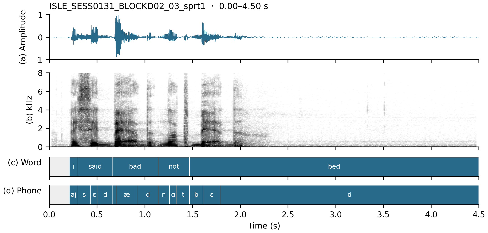

# Speech Representation

This project uses Montreal Forced Aligner (MFA) to put word and phone timestamps on six recordings from the supplied zip. There are 97.16 seconds of audio, 243 words and 150 distinct spellings.

## Run it

Extract the zip under `forced_alignment/data/` so its `wav/` and `transcripts/` folders sit together. Raw audio and transcripts stay local. The three NIST SPHERE files are copied to PCM WAV at their original 16 kHz.

```bash
conda env create -f forced_alignment/environment.yml
conda activate speech-align
python forced_alignment/run.py
```

The script downloads and checksums the pinned acoustic, dictionary, and G2P releases. Use `--wav PATH --transcripts PATH` to point to another extraction. Use `--stage dictionary` to stop after building the lexicon or `--stage plot` to regenerate analysis and figures from a completed run.

## Results

All six files aligned in each of the four runs. The English MFA 3.1.0 baseline missed six spellings across seven tokens (2.9%). The corpus dictionary kept the official pronunciations and added G2P candidates for those six spellings, removing all seven unknown-phone intervals. The saved US ARPA 3.0.0 run kept 64 of 243 word intervals unchanged from baseline. Widening the baseline beams from 10/40 to 100/400 left all 243 unchanged.

The biggest shift is at “bed”. English MFA carries the final /d/ to 4.50 s, while US ARPA ends it at 2.06 s, near the start of the quiet tail. The two GMM–HMM models use different phone sets and training data. There are no hand-labelled boundaries or verified speaker IDs, and 97 seconds was too little for a separate adaptation study. Review the G2P candidates for the names before reusing the dictionary.



In Praat, open the prepared WAV from `forced_alignment/work/run/corpus/` and its matching TextGrid from `forced_alignment/Results/TextGrids/`. Select both objects and choose **View & Edit**. The [results summary](forced_alignment/Results/summary.json) includes timings and boundary statistics.

[MFA documentation](https://montreal-forced-aligner.readthedocs.io/) · [Official model releases](https://github.com/MontrealCorpusTools/mfa-models/releases) · [McAuliffe et al., 2017](https://doi.org/10.21437/Interspeech.2017-1386)
